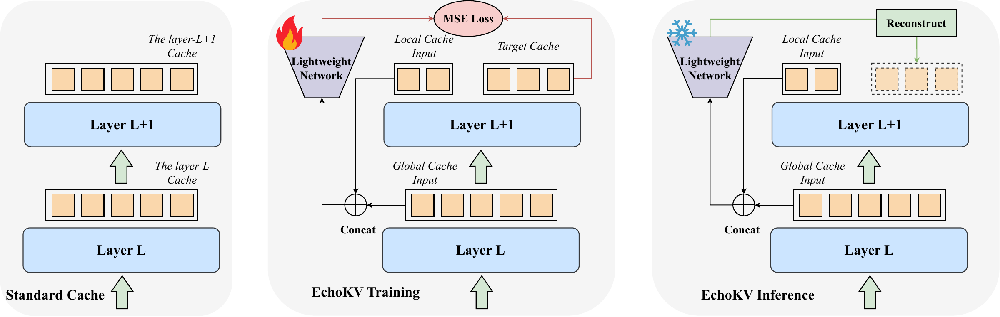

# EchoKV: Efficient KV Cache Compression via Similarity-Based Reconstruction [NeurIPS 2026]

This is the official implementation of our **NeurIPS 2026** paper,
*EchoKV: Efficient KV Cache Compression via Similarity-Based Reconstruction*.

EchoKV is a flexible KV cache compression framework for long-context LLM inference.
It retains a full anchor cache within each layer group and a small subset of local
KV dimensions, then uses lightweight linear predictors to reconstruct discarded
components by exploiting inter-layer and intra-layer similarities. A two-stage
training procedure first optimizes KV reconstruction and then attention-output
alignment while keeping the backbone frozen. EchoKV supports on-demand transitions
from FullKV to compressed caching, offering a competitive quality–cache trade-off
across multiple backbones and cache budgets on LongBench and RULER.



*Overview of EchoKV training and inference compared with standard KV caching.*

See [EXPERIMENTS.md](EXPERIMENTS.md) for the three-model main experiments and
Llama ablation, Hybrid, and adaptive-inference commands.

## Installation

```bash
conda create -n echokv python=3.11.14 pip -y
conda activate echokv
python -m pip install torch==2.6.0 --index-url https://download.pytorch.org/whl/cu126
python -m pip install -r requirements.txt
```

Install FlashAttention-2 separately.

## Training

Set the model path, then launch the standard or hybrid pipeline:

```bash
export MODEL_PATH=/path/to/Meta-Llama-3.1-8B-Instruct
bash run_training.sh
bash run_training_think.sh
```

Both pipelines run two stages with batch size 1 and learning rate `5e-4`:

1. KV-MSE for 600 steps, saving `checkpoint-600.pt`.
2. O-MSE for 1,000 steps, initialized from that Stage-1 checkpoint.

The cosine scheduler horizons are 1,000 and 2,000 steps respectively.

The standard pipeline writes to `training_results/`; the hybrid writes to
`training_results_hybrid/`. With the default `BLOCK_SIZE=2` and
`TOTAL_SAVE_DIM=0`, the final checkpoint is:

```text
<training_root>/block2_save0_kvmse_600_omse/checkpoint-1000.pt
```

The default dataset is the bundled `data/LongAlpaca-1k.json`, reused across both
stages. Set `DATASET_PATH` to use another training JSON with at least 1,000 records.

For another training dataset or output directory:

```bash
DATASET_PATH=data/alpaca-1k.json TRAINING_ROOT=outputs/alpaca \
    bash run_training.sh
```

`BLOCK_SIZE` and `TOTAL_SAVE_DIM` configure the EchoKV predictors. The hybrid
also accepts `COMPRESS_RATIO` (default `0.5`), the retained key dimension
fraction used by ThinK. Use matching settings during training and evaluation.

## LongBench evaluation

First prepare the complete benchmark (see [experiment interfaces](EXPERIMENTS.md)):

```bash
python -m pip install -r requirements-data.txt
python prepare_data.py longbench
```

After training:

```bash
bash run_longbench.sh
bash run_longbench_think.sh
```

Each launcher runs inference followed by scoring in the same environment.
By default, it evaluates all 16 tasks and finds the corresponding final
checkpoint under its training root.

To select a checkpoint, data directory, tasks, and output directory:

```bash
MLP_PATH=/path/to/checkpoint-1000.pt \
DATA_DIR=/path/to/LongBench \
DATASETS="narrativeqa qasper" \
SAVE_DIR=outputs/longbench \
    bash run_longbench.sh
```

Data files use the layout `<DATA_DIR>/<dataset>.jsonl`. For a single-task example
with the bundled data, use `DATASETS=narrativeqa bash run_longbench.sh`.

Use `METHOD=base bash run_longbench.sh` to evaluate FullKV without a predictor
checkpoint. Direct Python evaluation also accepts `--data_dir`, or
`--data_file` for one explicitly selected dataset.

## Paths and configuration

Launchers can be called from outside the repository. User-supplied relative
paths are resolved from the directory where the launcher was invoked;
built-in defaults are resolved from the repository root. `MODEL_PATH` accepts
a local directory or a Hugging Face model ID.

| Variable | Purpose / default |
|---|---|
| `MODEL_PATH` | Required local model directory or Hugging Face ID |
| `PYTHON_BIN` | Python executable; `python` from the active environment |
| `CUDA_VISIBLE_DEVICES` | Optional GPU selection; inherited without changes |
| `DATASET_PATH` | Training JSON; bundled `data/LongAlpaca-1k.json` |
| `TRAINING_ROOT` | Training outputs and default checkpoint lookup |
| `MLP_PATH` | Override the predictor checkpoint for evaluation |
| `DATA_DIR` | LongBench JSONL directory; bundled `data/LongBench/` |
| `DATASETS` | Space-separated LongBench tasks; `all` (16 tasks) |
| `SAVE_DIR` | Evaluation output directory |
| `BLOCK_SIZE` / `TOTAL_SAVE_DIM` | Predictor configuration; `2` / `0` |
| `COMPRESS_RATIO` | Hybrid ThinK retained key fraction; `0.5` |
| `METHOD` | Evaluation mode: `echo` (default) or `base` |
| `ATTN_IMPLEMENTATION` | Evaluation attention backend; `flash_attention_2` |
